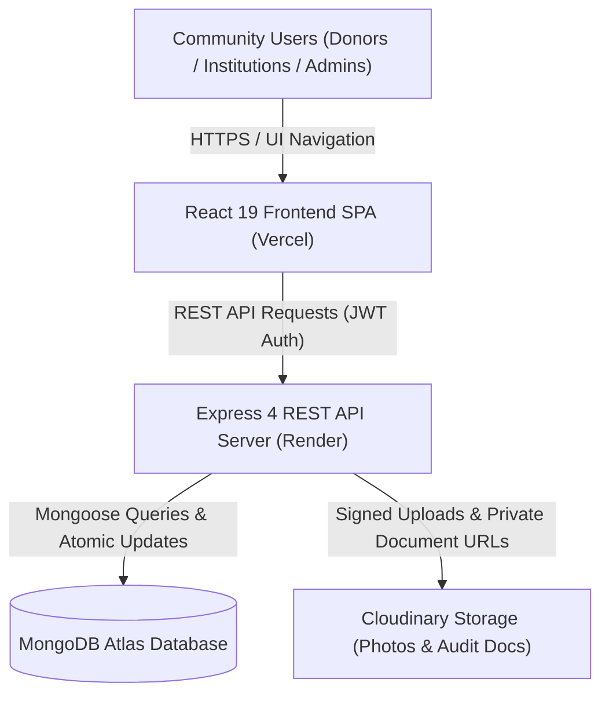
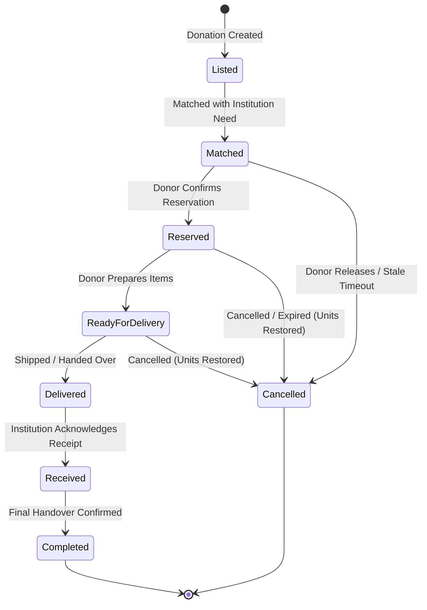

# Samanvitha

> **Resources aligned with real needs**  
> *Vanarulu avasaralatho samanvayam pondhinappude nijamaina prayojanam*

---

## Overview & Problem Statement

**Samanvitha** is a need-based community donation network designed to bridge the gap between conscientious donors and verified care institutions (orphanages and old-age homes). Traditional charity workflows frequently result in logistical mismatches—orphanages receive surplus perishable cooked food on festival days while experiencing severe, chronic shortages of school notebooks, textbooks, daily medicines, and dry food grains. Samanvitha replaces arbitrary giving with **transparent, deficit-driven alignment**: community needs are quantified in real time, and donor contributions are algorithmically paired with verified shortages based on institutional urgency, remaining demand, fulfillment deadlines, and travel distance.

---

## Live Deployments & Service Status

| Service | Environment | Live URL | Status & Health |
| :--- | :--- | :--- | :--- |
| **Frontend Web App** | Production (Vercel) | [https://samanvitha.vercel.app](https://samanvitha.vercel.app) | Single-page React application |
| **Backend REST API** | Production (Render) | [https://samanvitha.onrender.com/api/health](https://samanvitha.onrender.com/api/health) | Node.js / Express health monitor |

> [!NOTE]
> **Free-Tier Cold Start Notice:**  
> The backend REST API is hosted on Render's free tier, which automatically spins down into an inactive state after 15 minutes of zero traffic. When opening the live site after an idle period, the first request can take **50 to 60 seconds** while the container boots and connects to MongoDB Atlas.  
> The frontend incorporates an automatic wake-up ping, an extended 70-second request timeout, and a calm status indicator (*"The server is waking up (free hosting). This can take up to a minute, please wait."*) to ensure a smooth, transparent user experience.

---

## Features by Role

### 1. Donor
- **Public Needs Exploration**: Browse active, real-time supply deficits across verified homes with instant category and urgency filters.
- **Deficit-Aware Contribution**: Pledge non-perishable goods across three vetted categories: *Clothes (including sarees)*, *Books and educational supplies*, and *Rice and packaged dry essentials*.
- **Algorithmic Match Suggestions**: View ranked suggestions for any listed donation with a full 4-component mathematical score breakdown.
- **Partial Reservations**: When a donation offers more items than a home requires, the donor reserves only the required deficit, leaving the remainder listed and available for other institutions.
- **72-Hour Reservation Expiry**: Unfulfilled reservations automatically release back to the community after 72 hours so need deficits never stay locked indefinitely.
- **Interactive Map & Distance Calculation**: View nearby orphanages and old-age homes on an interactive Leaflet map with Haversine distance computations.
- **Lifecycle Tracking**: Monitor contributions across an 8-stage progress tracker from initial listing to institutional receipt acknowledgment.

### 2. Care Institution (Orphanages & Old-Age Homes)
- **Inventory Deficit Ledger**: Publish and manage specific item needs with explicit required counts, current shelf stock, deadlines, and acceptable condition notes.
- **Live Deficit Formula**: Quantities update dynamically via the strict formula:  
  $$\text{Remaining Deficit} = \max(0, \text{Required Quantity} - \text{Usable Stock} - \text{Reserved Quantity})$$
- **Over-Allocation & Edit Guards**: The server strictly rejects edits where `requiredQuantity < reservedQuantity`. If an institution lowers a requirement below current usable stock + reserved units, the UI prompts confirmation and automatically marks the need as fulfilled.
- **Status Badges**: Visual indicator tags reflect actual stock health across all views:
  - **Surplus** (neutral sand): Shelf stock meets or exceeds total demand with zero units in transit (`usableStock >= required && reserved === 0`).
  - **Over-Allocated** (warning amber): Reserved in-transit units exceed remaining unfulfilled demand (`reserved > max(0, required - usableStock)`).
  - **Fulfilled** (sage green): Unfulfilled demand is 0 and no over-allocation exists.
  - **Open**: Active deficit waiting for community pledges.
- **Delivery Acknowledgment**: Single-click receipt confirmation that atomically converts reserved items into confirmed usable inventory.
- **Prototype Verification Profile**: Upload regulatory certificates, specify capacity, and track verification status.

### 3. Administrator & Auditor
- **Institutional Verification Portal**: Audit registration applications, inspect uploaded regulatory certificates, and approve or reject care institutions with structured audit rationale.
- **Users Directory**: Comprehensive roster of registered individual donors, retail shops, and institutional directors.
- **System Analytics**: Real-time visual Recharts dashboards tracking category supply distributions, need fulfillment percentages, and donation lifecycle velocity.
- **Disputes & Delays Oversight**: Monitor flagged delivery delays, damaged package reports, and unfulfilled pledges.

---

## How Matching Works

Matching on Samanvitha is deterministic, transparent, and completely free of popularity bias.

```
Candidate Needs Pool
       │
       ▼
┌────────────────────────────────────────────────────────┐
│               Eligibility Pre-Filters                  │
│  1. Category Match (e.g. Rice matches Rice only)       │
│  2. Institution Verification Status == "Approved"      │
│  3. Need Status == "Open"                              │
│  4. Remaining Deficit > 0                              │
└────────────────────────────────────────────────────────┘
       │
       ▼
┌────────────────────────────────────────────────────────┐
│          Weighted Scoring Engine (0 - 100)             │
│  • Need Urgency (35%)                                  │
│  • Unfulfilled Demand (30%)                            │
│  • Time Sensitivity (20%)                              │
│  • Delivery Feasibility (15%)                          │
└────────────────────────────────────────────────────────┘
       │
       ▼
Ranked Match Suggestions (Sorted Descending by Final Score)
```

### 1. Eligibility Filters
A need is eligible to receive a donation only if:
1. **Category Match**: The donation category matches the need category exactly.
2. **Institutional Approval**: The beneficiary institution has been reviewed and marked as `Approved` by an administrator.
3. **Active Deficit**: The need is in `Open` status with a remaining deficit greater than 0. Needs with 0 remaining deficit are strictly excluded from match suggestions and reject incoming reservation requests.

### 2. Multi-Component Scoring Formula
Every eligible pair receives a composite score between 0 and 100:

$$\text{Final Score} = (S_{\text{urgency}} \times 0.35) + (S_{\text{demand}} \times 0.30) + (S_{\text{time}} \times 0.20) + (S_{\text{feasibility}} \times 0.15)$$

- **Need Urgency (35% weight)**:  
  Reflects critical stock shortages:
  - `Critical`: 100 points
  - `High`: 75 points
  - `Medium`: 50 points
  - `Low`: 25 points
- **Unfulfilled Demand (30% weight)**:  
  Evaluates how effectively the donation fulfills the institution's remaining gap without causing waste:  
  $$\text{Demand Score} = \min\left(100, \frac{\min(\text{Donation Available}, \text{Remaining Need})}{\text{Remaining Need}} \times 100\right)$$
- **Time Sensitivity (20% weight)**:  
  Measures proximity to the institutional deadline:
  - $\le 3\text{ days}$: 100 points
  - $\le 7\text{ days}$: 85 points
  - $\le 14\text{ days}$: 70 points
  - $\le 30\text{ days}$: 50 points
  - $> 30\text{ days}$ or ongoing: 30 points
- **Delivery Feasibility (15% weight)**:  
  Calculated using the **Haversine formula** between donor coordinates $(\text{lat}_1, \text{lon}_1)$ and institution coordinates $(\text{lat}_2, \text{lon}_2)$:
  - $\text{Distance} \le 2\text{ km}$: 100 points
  - $\text{Distance} \ge 50\text{ km}$: 0 points
  - $2\text{ km} < \text{Distance} < 50\text{ km}$: Decreases linearly from 100 to 0
  - **Distance Unknown**: If coordinates are missing on either side, a neutral score of **50 points** is assigned (*"Distance unknown"*), preventing arbitrary penalties.

### Strict Anti-Bias Guarantee
Samanvitha's algorithm never factors in institutional popularity, follower counts, donor wealth, or celebrity patronage. Every verified home has equal algorithmic visibility based strictly on verified deficit and geographical proximity.

---

## System Architecture & Tech Stack

### Technology Stack
- **Frontend**: React 19, Vite 8, Tailwind CSS v3.4, React Router v7, Leaflet & OpenStreetMap, Recharts, Lucide React (Deployed on Vercel).
- **Backend**: Node.js, Express 4, Mongoose 8 ODM, Helmet, CORS, Express Rate Limit, Nodemailer, Cloudinary SDK (Deployed on Render).
- **Database**: MongoDB Atlas (Cloud Replica Set).
- **Media & Document Storage**: Cloudinary (Public donation photos and private, signed institutional audit documents).

### Architecture Diagram



### Donation Lifecycle Flow



---

## Concurrency & Data Integrity

In high-volume community donation systems, concurrent reservations can easily lead to **over-allocation** (where total reserved and on-hand stock exceeds what a home requested). Samanvitha enforces strict data integrity through database-level atomic primitives:

1. **Atomic Conditional Reservations**:  
   Reservations use MongoDB `$expr` conditional operators within an atomic `findOneAndUpdate` statement:
   ```javascript
   $expr: {
     $gte: [
       { $subtract: ['$requiredQuantity', { $add: ['$usableStock', '$reservedQuantity'] }] },
       requestedQty
     ]
   }
   ```
   If two donors attempt to reserve the last 10 units of notebooks simultaneously, MongoDB guarantees that exactly one operation succeeds and the other is safely rejected.
2. **Partial Reservation Splitting**:  
   If a donor offers 20 units to a need that only has a remaining deficit of 15, the system reserves exactly 15 units. The original donation record is atomically decremented to 5 units and remains `Listed` for other orphanages, eliminating artificial shortages.
3. **Idempotent Receipt Acknowledgment**:  
   When a home confirms delivery, an atomic update increments `usableStock` by the exact reserved count and decrements `reservedQuantity` by the same count in a single database step.
4. **Idempotent Cancellation & Expiry**:  
   If a reservation expires or is cancelled, the reserved units on the need are decremented once, and the donation units are restored to available inventory.

---

## Security & Privacy Protections

- **JWT Authentication**: Secure JSON Web Tokens with 7-day lifespans stored locally and validated on every protected API call.
- **Password Protection**: Passwords hashed using `bcryptjs` with salt rounds; credentials are never logged, returned in API responses, or stored in plaintext.
- **Server-Side Role-Based Access Control (RBAC)**: Route middleware validates user identity and strict role permissions (`donor`, `institution`, `admin`).
- **Private Verification Documents**: Institutional registration certificates are uploaded to Cloudinary as `authenticated`/`private` assets and are served only through time-limited signed URLs to authorized reviewers.
- **API Hardening**: Express `helmet` headers, CORS origin allow-listing (`CLIENT_URL`), and `express-rate-limit` caps against brute-force attacks (100 requests per 15 minutes globally, 10 requests per 15 minutes on authentication endpoints).
- **Production Secret Validation**: In production (`NODE_ENV=production`), the backend validates that `JWT_SECRET` is strong ($\ge 32$ characters), default demo administrator passwords are replaced, and ephemeral local disk storage is prohibited.

---

## Local Development Setup

Follow these steps to run Samanvitha locally on your machine.

### Prerequisites
- [Node.js](https://nodejs.org/) (version 18 or newer)
- [MongoDB](https://www.mongodb.com/) (local instance running on port 27017 or a free MongoDB Atlas connection string)
- [Git](https://git-scm.com/)

### Step 1: Clone the Repository
```bash
git clone https://github.com/saideepika07/samanvitha.git
cd samanvitha
```

### Step 2: Configure Environment Files
Copy the example configuration templates:

```bash
# Server configuration
cp server/.env.example server/.env

# Client configuration
cp client/.env.example client/.env
```

Open `server/.env` and verify the settings:
- `MONGODB_URI`: `mongodb://127.0.0.1:27017/samanvitha` (or your Atlas connection string)
- `JWT_SECRET`: A secure random string (minimum 32 characters in production)
- `PORT`: `5000`

### Step 3: Install Dependencies
```bash
# Install server packages
npm --prefix server install

# Install client packages
npm --prefix client install
```

### Step 4: Provision the Initial Administrator
Run the built-in seeding utility to provision the initial administrator account:

```bash
cd server
npm run create-admin
cd ..
```

### Step 5: Start Development Servers
Run both backend and frontend development servers in separate terminal windows:

```bash
# Terminal 1: Backend API (runs on http://localhost:5000)
npm --prefix server run dev

# Terminal 2: Frontend Client (runs on http://localhost:5173)
npm --prefix client run dev
```

Open your browser and navigate to **`http://localhost:5173`**.

---

## Automated Testing & Quality Assurance

The project includes automated integration and unit test suites covering authentication, over-allocation prevention, partial reservations, algorithmic matching, database safety, dispute handling, institutional audit workflows, and server health.

### Running Test Suites
```bash
# Run all server test suites
npm --prefix server test

# Verify production frontend build
npm --prefix client run build
```

### Latest Verified Test Results
- **Server Test Suites**: **18 passed**, 18 total (100% pass rate)
- **Individual Tests**: **175 passed**, 175 total
- **Frontend Production Build**: `vite build` completed cleanly with 0 errors (2,640 modules transformed).

---

## Honest Limitations

1. **Prototype Verification Standing**: Institutional review workflows demonstrate administrative auditing and document examination for system demonstration; they do not constitute legal verification under state or central government statutes.
2. **OpenStreetMap & Geocoding Coverage**: Distance calculations rely on public OpenStreetMap and Nominatim data. Coverage in dense rural localities or unmapped lanes can vary, and public fair-use limits (1 request/second) apply.
3. **Free-Tier Cloud Cold Starts**: The production backend runs on Render's free tier, which sleeps after 15 minutes of inactivity and requires ~50–60 seconds to boot on first request.
4. **Password Reset Email Dispatch**: In development, password reset links are printed directly to the server terminal console (`[DEV ONLY]`). Delivering reset emails to live inboxes requires configuring valid SMTP credentials (e.g., Gmail App Password or Brevo).
5. **Logistics & Volunteer Scopes**: In the current v1 release, physical transport is coordinated directly between donors and recipient homes. Third-party volunteer drivers and NGO logistics hubs are reserved for future phases.

---

## Future Scope & Roadmap

- **Volunteer Delivery Network**: Mobile-friendly routing module enabling volunteer drivers to claim, bundle, and deliver matched packages.
- **NGO DARPAN Integration**: Automated verification against the Government of India DARPAN registry for institutional authenticity.
- **WhatsApp & SMS Notifications**: Transactional message notifications for match confirmations, pickup reminders, and delivery handovers.
- **Multi-Branch Institutional Ledgers**: Hierarchical inventory tracking for organizations operating multiple care homes across districts.
- **Retail Drop-off Hubs**: Partnerships with local grocery shops and stationers to serve as designated neighborhood collection points.

---

## License

This project is licensed under the [MIT License](LICENSE).
